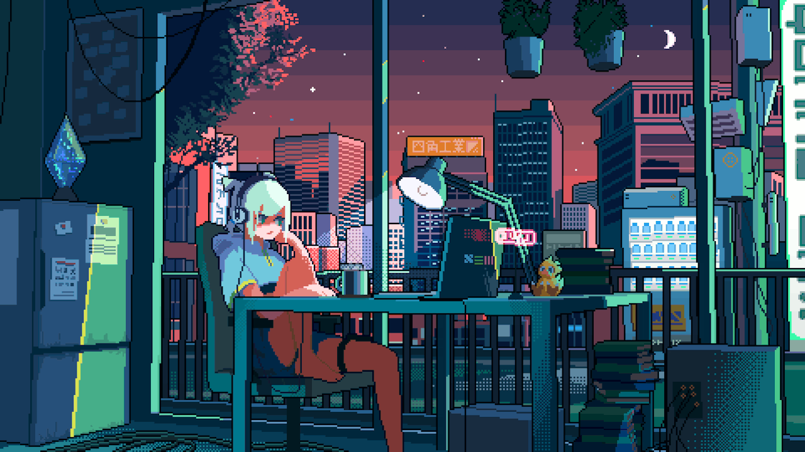

## Hi There, Welcome to my GitHub profile! 👋🏻

 
 

I'm a passionate software engineering student with a strong desire to learn and constantly improve my skills. I am highly motivated and dedicated to my work, and I am always looking for new opportunities to challenge myself and expand my knowledge.

I'm currently studying at [UM6P - 1337](https://1337.ma) and based in Benguerir, Morocco.

Please feel free to clone/fork projects, raise issues and submit PRs if you think something could be better. 
Ask me anything **[here](https://github.com/AfafTarchoun/AfafTarchoun/issues/new)** or <a href="mailto:atarchou@student.1337.ma"><b>send me an email</b></a>.
 
 

 
 

 
 

**Happy Coding!** 😊

